# Hi, I'm Mohith

CS at Duke (AI/ML concentration). I build AI agents and the systems that keep them honest: voice agents that won't act without a spoken yes, evals for LLM judges, and tools that trace where a model's behavior comes from.

**Now**
- Undergraduate researcher at **Duke**: conformal prediction for chemo-infusion scheduling (Zavlanos Lab), a Claude + Three.js study builder (MADLAB), and a C rewrite that made a genomics pipeline 20x faster (Dietrich Lab)

**Before**
- **Harbor Capital** (SWE intern): multi-agent underwriting pipeline, a Monte Carlo pricing engine, and a fund-admin rebuild in Next.js + Postgres
- **Polymr** (SWE - Contract)

## Things I've built

| Project | What it is |
|---|---|
| [**Ava**](https://portal.mohithgajjela.com/demo) | Full-duplex voice agent for a patient portal. 43 tools, barge-in, and no write without a spoken yes (0 unconfirmed writes in 34 test sessions) |
| [**Gavel**](https://gavel.mohithgajjela.com) · [code](https://github.com/Mohith26/gavel-live) | Paste a lecture or podcast, get a claim-by-claim evidence check. Judge calibrated on a 1,064-claim benchmark (F1 0.83) |
| [**Culprit**](https://culprit-production.up.railway.app) | Training-data debugger: traces a fine-tuned model's bad behavior back to the examples that caused it |
| [**Windlass**](https://github.com/Mohith26/windlass) | Raft implementation tested with a deterministic network simulator |
| [**Preflight**](https://github.com/Mohith26/preflight) | Runs an npm package's install scripts under instrumentation and diffs what changed between versions |
| [**Mosaic**](https://mohithgajjela.com/system-05-mosaic) · [code](https://github.com/Mohith26/mosaic) | Pinterest-style visual discovery on real CLIP embeddings and a pin-board graph |

## Open source

Merged work includes fixes in [LangChain](https://github.com/langchain-ai/langchain/pull/39101), [Deep Agents](https://github.com/langchain-ai/deepagents/pull/5107), [Cloudflare workers-sdk](https://github.com/cloudflare/workers-sdk/pull/14921), [Vercel Chat SDK](https://github.com/vercel/chat/pull/755), [n8n](https://github.com/n8n-io/n8n/pull/35139), [Qdrant fastembed](https://github.com/qdrant/fastembed/pull/655) and [Strapi](https://github.com/strapi/strapi/pull/27161).

## Tools

Python · TypeScript · C/C++ · SQL · Go · React/Next.js · FastAPI · PostgreSQL · Redis · Cloudflare Workers/D1/Durable Objects · Claude API · Gemini · LangChain · evals

[mohithgajjela.com](https://mohithgajjela.com) · [LinkedIn](https://www.linkedin.com/in/mohith-gajjela/)
